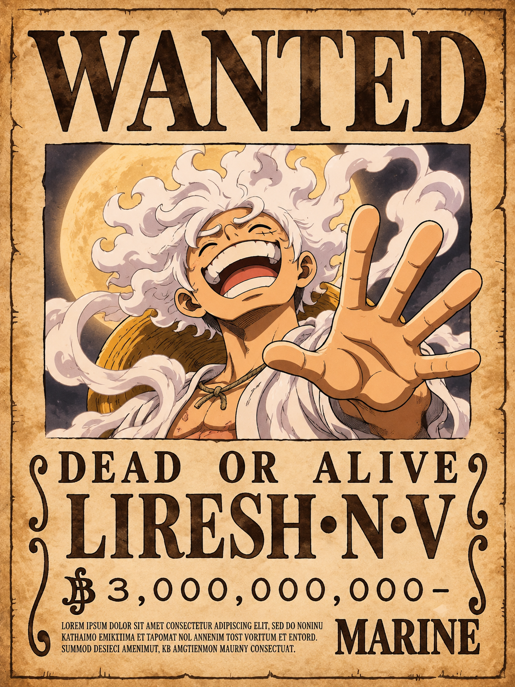
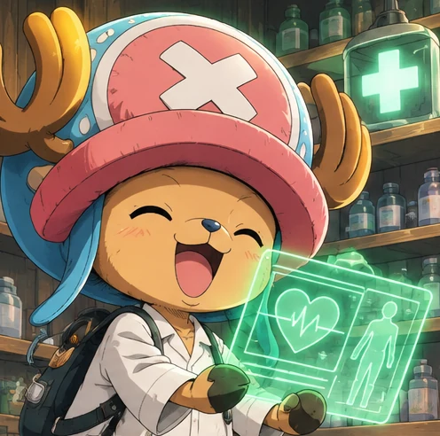
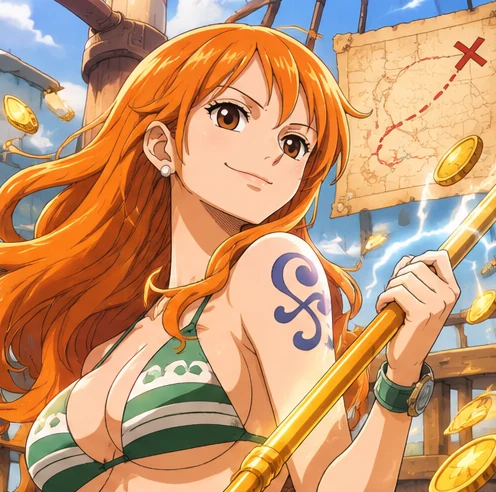
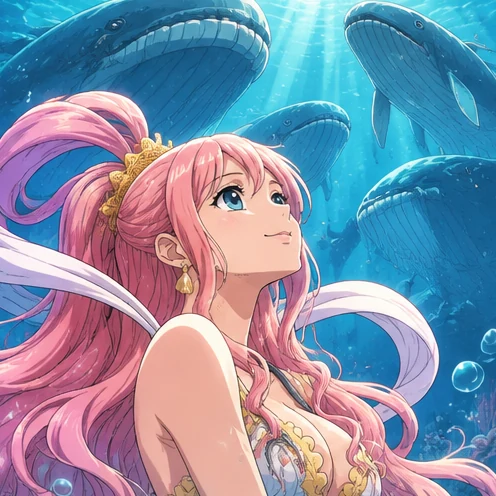
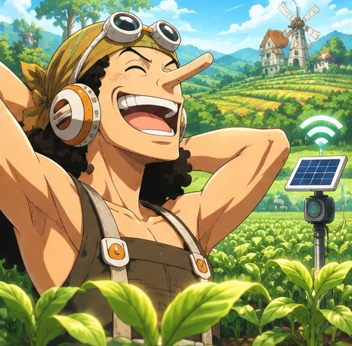
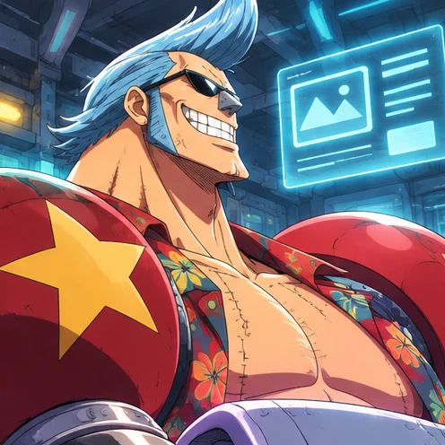

  
  
   
  
  
  
  

---

<table border="0" width="100%">
  <tr>
    <td width="70%" valign="middle">
      <h3>HEY, I'M LIRESH.</h3>
      <b>AI / ML Undergraduate · Developer · Builder</b>
        
      I build AI-powered products, multi-agent workflows and practical software.
        
      RAJALAKSHMI ENGINEERING COLLEGE · CHENNAI, INDIA
       
      FOCUS: APPLIED AI · AGENTIC SYSTEMS · BACKEND · DATA · DSA
    </td>
    <td width="30%" align="center" valign="middle">
      
       
      GEAR 5 · 3,000,000,000 BERRIES
    </td>
  </tr>
</table>

  <h3>⚡ SIX BUILDS · SIX ISLANDS</h3>
  Ideas with a purpose. Systems with a story.

<table border="0" width="100%" cellspacing="0" cellpadding="10">
  <tr>
    <td width="50%" valign="middle">
      
      <b>AURA</b> 
      CHOPPER · THE DOCTOR 
      Personal-baseline well-being intelligence with explainable early warnings and human-led support.
       
    </td>
    <td width="50%" valign="middle">
      
      <b>SkillDex</b> 
      ROBIN · THE SCHOLAR 
      A living skill graph for verified skills, gap analysis, learning paths and career matching.
       <a href="https://github.com/lireshnv/skilldex">SOURCE ↗</a>
       
    </td>
  </tr>
  <tr>
    <td width="50%" valign="middle">
      
      <b>InvoiceIQ</b> 
      NAMI · THE NAVIGATOR 
      Zero-OCR invoice intelligence: extraction, PO/vendor checks, duplicate signals and risk-based routing.
       
    </td>
    <td width="50%" valign="middle">
      
      <b>Project Poseidon</b> 
      SHIRAHOSHI · THE SEA PRINCESS 
      Water-contamination patterns, anomaly signals and predictive public-health early warning.
       
    </td>
  </tr>
  <tr>
    <td width="50%" valign="middle">
      
      <b>Agent Agro</b> 
      USOPP · THE INVENTOR 
      Five agents connect farm insights, harvest inventory, food rescue, logistics and orchestration.
       
    </td>
    <td width="50%" valign="middle">
      
      <b>GOTCHA</b> 
      FRANKY · THE CYBORG 
      On-device screenshot AI that turns images into searchable, connected personal memory.
       
    </td>
  </tr>
</table>

---

  <h3>🧰 THE TOOLKIT</h3>
  
   
  Python · Java · C/C++ · C# · TypeScript · JavaScript · SQL · React · FastAPI · Node.js · AI/ML · APIs · Databases

---

  <h3>📊 THE VOYAGE SO FAR</h3>
  
  
   
  
   
  

### 🐍 CONTRIBUTION SNAKE

  <picture>
    <source media="(prefers-color-scheme: dark)" srcset="https://raw.githubusercontent.com/lireshnv/lireshnv/output/github-contribution-grid-snake-dark.svg" />
    <source media="(prefers-color-scheme: light)" srcset="https://raw.githubusercontent.com/lireshnv/lireshnv/output/github-contribution-grid-snake.svg" />
    
  </picture>

---

  <h3>📡 FIND ME</h3>
  <a href="https://github.com/lireshnv">GITHUB</a> &nbsp;·&nbsp;
  <a href="https://www.linkedin.com/in/liresh-nv/">LINKEDIN</a> &nbsp;·&nbsp;
  <a href="https://leetcode.com/">LEETCODE</a> &nbsp;·&nbsp;
  <a href="https://liresh.online">PORTFOLIO</a>
    
  
    
  
   
  THE NEXT ISLAND IS ALWAYS WORTH EXPLORING.

